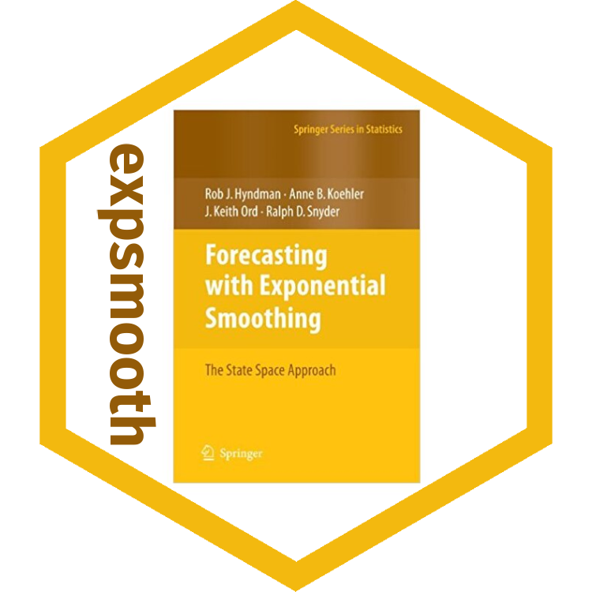
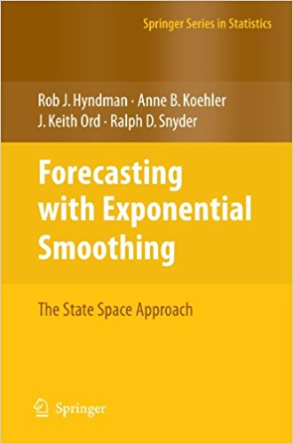

# expsmooth 

[](https://cran.r-project.org/package=expsmooth)
[](https://cran.r-project.org/package=expsmooth)
[](https://cran.r-project.org/web/licenses/GPL-3)

An R package containing data from the book ["Forecasting with Exponential Smoothing: The State Space Approach" by Hyndman, Koehler, Ord and Snyder (Springer, 2008)](https://robjhyndman.com/expsmooth/).

[](https://robjhyndman.com/expsmooth/)

## Installation

You can install the released version from [CRAN](https://cran.r-project.org/package=expsmooth):

```r
install.packages("expsmooth")
```

or the development version from [GitHub](https://github.com/robjhyndman/expsmooth):

```r
# install.packages("pak")
pak::pak("robjhyndman/expsmooth")
```

## Example

Loading the package also loads the [forecast](https://pkg.robjhyndman.com/forecast/) package, which can be used to fit exponential smoothing state space models to the data.

```r
library(expsmooth)
fit <- ets(visitors)
autoplot(forecast(fit))
```
