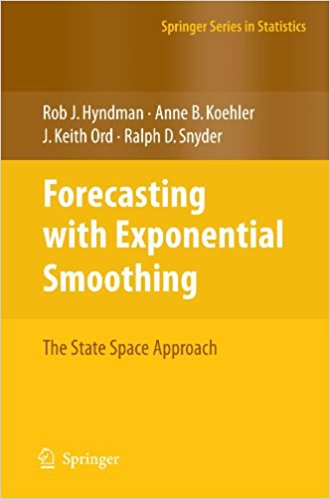

```{r}
#| label: setup
#| include: false

knitr::opts_chunk$set(
  collapse = TRUE,
  comment = "#>"
)
```

# Introduction

This package contains a collection of data sets that are designed to accompany the book [*Forecasting with Exponential Smoothing: The State Space Approach*](https://doi.org/10.1007/978-3-540-71918-2) by Rob J. Hyndman, Anne B. Koehler, J. Keith Ord, and Ralph D. Snyder (Springer, 2008).

[](https://robjhyndman.com/expsmooth/)

When the `expsmooth` package is loaded, the `forecast` package is also loaded, providing the functions to fit and forecast with exponential smoothing state space models.
We also use `ggplot2` and `patchwork` for the graphs.

```{r}
#| label: packages
#| message: false

library(expsmooth)
library(ggplot2)
library(patchwork)
```

This vignette follows the analysis in **Section 2.8** of the book, and provides worked solutions to **Exercises 2.3** and **2.4**.
The forecast package has been updated since the book was published, so some of the resulting models and estimates differ from those in the book.
Figure numbers are taken from the book.

# Data sets

Chapters 1 and 2 use four data sets that are included in the `expsmooth` package.

- **bonds**: 125 monthly US government bond yields (percent per annum) from January 1994 to May 2004.
- **usnetelec**: 55 observations of annual US net electricity generation (billion kWh) for 1949 through 2003.
- **ukcars**: 113 quarterly observations of passenger motor vehicle production in the UK (thousands of cars) for the first quarter of 1977 through the first quarter of 2005.
- **visitors**: 240 monthly observations of the number of short-term overseas visitors to Australia from May 1985 to April 2005.

These time series are shown in **Figure 1.1**, which is reproduced below.

```{r}
#| label: fig-1-1
#| fig-width: 8
#| fig-height: 5
#| fig-alt: >
#|   Four time series plots.
#|   (a) US 10-year bond yields, 1994 to 2004, wandering between about 3.5 and 8 percent with a downward drift.
#|   (b) US net electricity generation, 1949 to 2003, rising steadily from about 300 to nearly 4000 billion kWh.
#|   (c) UK passenger vehicle production, 1977 to 2005, falling to about 200 thousand in the early 1980s then rising to around 400 thousand, with quarterly fluctuations.
#|   (d) Overseas visitors to Australia, 1985 to 2005, rising from about 100 to 500 thousand with a strong seasonal pattern that grows with the level.

plot_bonds <- autoplot(bonds) +
  labs(
    title = "(a) US 10-year bond yields",
    x = "Year",
    y = "Percentage per annum"
  )
plot_usnetelec <- autoplot(usnetelec) +
  labs(
    title = "(b) US net electricity generation",
    x = "Year",
    y = "Billion kWh"
  )
plot_ukcars <- autoplot(ukcars) +
  labs(
    title = "(c) UK passenger vehicle production",
    x = "Year",
    y = "Thousands of cars"
  )
plot_visitors <- autoplot(visitors) +
  labs(
    title = "(d) Overseas visitors to Australia",
    x = "Year",
    y = "Thousands of people"
  )
(plot_bonds | plot_usnetelec) /
  (plot_ukcars | plot_visitors)
```

# Automatic model selection and forecasting

This part of the vignette follows the automatic forecasting procedure described in **Section 2.8** of the book.
The book selected ETS(A,Ad,N) for bonds, ETS(M,Md,N) for usnetelec, ETS(A,N,A) for ukcars and ETS(M,A,M) for visitors.
The current version of the forecast package selects the same models for bonds, ukcars and visitors, but selects ETS(M,A,N) for usnetelec.

The estimation and model selection are performed by the `ets()` function and the forecasting is done by the `forecast()` function.
These are both part of the `forecast` package.
A basic introduction to using these functions is given in **Sections 7.6** and **7.7** of [*Forecasting: Principles and Practice*](https://otexts.com/fpp2/exponential-smoothing.html#estimation-and-model-selection) by Rob J Hyndman and George Athanasopoulos.

The automatic forecasting process will be carried out for each of the four data sets.
The process will be explained for the first data set, and the main results will be reported for the others.

## bonds

The `ets()` function fits all appropriate models (optimising parameters in each case), and then selects the best model according to the AICc.
The AICc is the default information criterion; the AIC or BIC can be used instead via the `ic` argument.
(The book used the AIC; for these four series the AIC and AICc select the same models.)

```{r}
fit_bonds <- ets(bonds)
summary(fit_bonds)
```

The `autoplot()` function can then be used to show the observed series together with the estimated level and slope components over time.

```{r}
#| fig-alt: >
#|   Three stacked panels for the bonds model: the observed series, the estimated level, which closely tracks the observed series, and the estimated slope, which fluctuates around zero.

autoplot(fit_bonds)
```

The `forecast()` function is used to produce point forecasts and prediction intervals.
When the `summary()` function is called on the forecast object, it prints the model information along with the point forecasts and prediction intervals.

```{r}
forecast_bonds <- forecast(fit_bonds, level = 80)
summary(forecast_bonds)
```

The `autoplot()` function can then be called on the forecast object to produce the graph shown in **Figure 2.1**.

```{r}
#| fig-alt: >
#|   US 10-year bond yields from 1994 to mid 2004, followed by two years of forecasts that level off at about 5 percent, with an 80 percent prediction interval that widens rapidly.

autoplot(forecast_bonds) +
  labs(
    title = "US 10-year bond yields",
    x = "Year",
    y = "Percentage per annum",
    caption = "Fig. 2.1a"
  )
```

## usnetelec

For the remaining series, we show the fitted model and the graph of the forecasts.

```{r}
#| fig-alt: >
#|   US net electricity generation from 1949 to 2003, followed by ten years of forecasts continuing the upward trend, with a widening 80 percent prediction interval.

fit_usnetelec <- ets(usnetelec)
fit_usnetelec
forecast_usnetelec <- forecast(fit_usnetelec, level = 80)
autoplot(forecast_usnetelec) +
  labs(
    title = "US net electricity generation",
    x = "Year",
    y = "Billion kWh",
    caption = "Fig. 2.1b"
  )
```

## ukcars

```{r}
#| fig-alt: >
#|   UK passenger vehicle production from 1977 to 2005, followed by two years of forecasts that repeat the quarterly seasonal pattern around a flat level, with an 80 percent prediction interval.

fit_ukcars <- ets(ukcars)
fit_ukcars
forecast_ukcars <- forecast(fit_ukcars, level = 80)
autoplot(forecast_ukcars) +
  labs(
    title = "UK passenger motor vehicle production",
    x = "Year",
    y = "Thousands of cars",
    caption = "Fig. 2.1c"
  )
```

## visitors

```{r}
#| fig-alt: >
#|   Overseas visitors to Australia from 1985 to 2005, followed by two years of forecasts that continue the upward trend and the growing monthly seasonal pattern, with an 80 percent prediction interval.

fit_visitors <- ets(visitors)
fit_visitors
forecast_visitors <- forecast(fit_visitors, level = 80)
autoplot(forecast_visitors) +
  labs(
    title = "Overseas visitors to Australia",
    x = "Year",
    y = "Thousands of people",
    caption = "Fig. 2.1d"
  )
```
